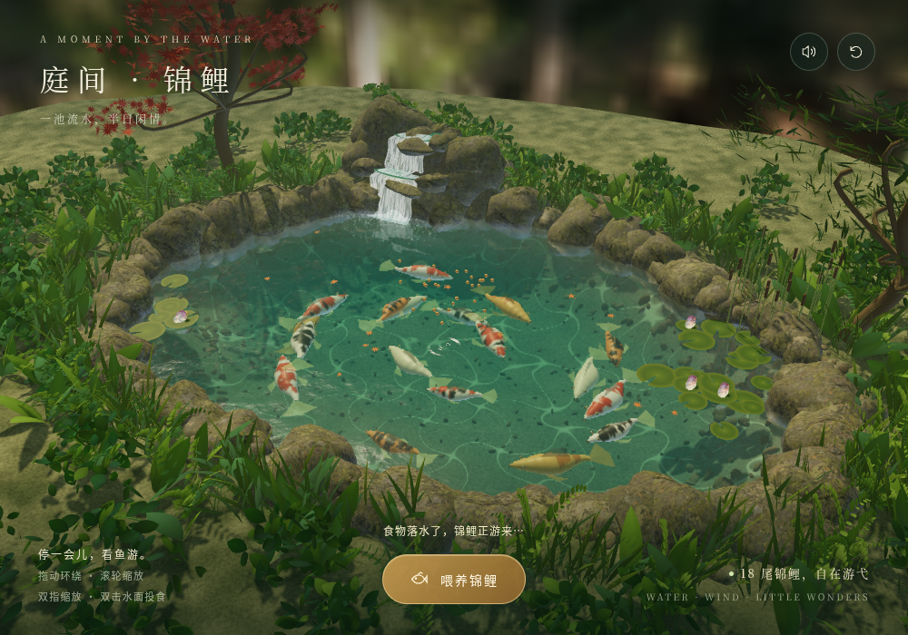

# 庭间 · 锦鲤

一座可以环绕探索、投食互动的 Three.js 三维锦鲤庭院。动态流水、风动花草、实时倒影、环境音与 18 尾锦鲤都封装在一个可独立运行的 HTML 文件中。



## 体验方式

- 拖动鼠标：环绕观察庭院
- 滚轮或双指缩放：拉近、拉远视角
- 双击水面或点击“喂养锦鲤”：投放鱼食
- 右上角按钮：开关环境音、重置视角

## 本地运行

项目没有构建步骤，也不需要安装依赖。下载后直接打开 `index.html` 即可；为获得更稳定的浏览器行为，也可以启动一个本地静态服务器：

```bash
python3 -m http.server 8080
```

然后访问 [http://localhost:8080](http://localhost:8080)。

## 技术说明

- Three.js r170 / WebGL
- 单文件实现，纹理、环境贴图和音频均内嵌
- 程序化锦鲤、岩石、植被、水面与瀑布动画
- 支持桌面端和触控设备
- 不需要后端、账号或 API Key

## 来源

代码来自妙搭应用“庭间 · 锦鲤”（`app_17gdhapey80`）的独立 HTML 源文件，整理为便于本地运行和 GitHub 托管的单页项目。

Three.js 使用 MIT License，相关版权声明保留在 `index.html` 中。
